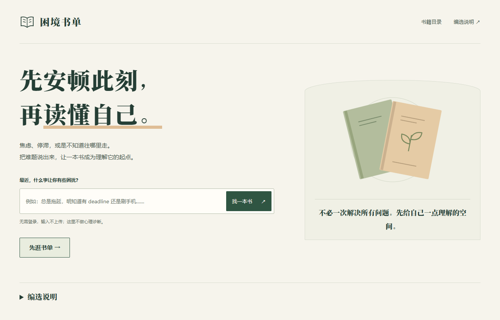
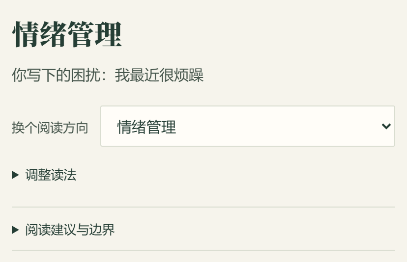
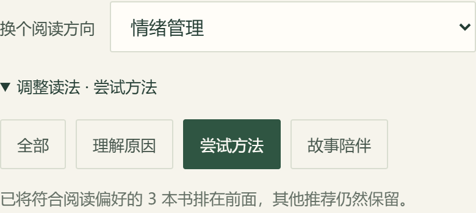
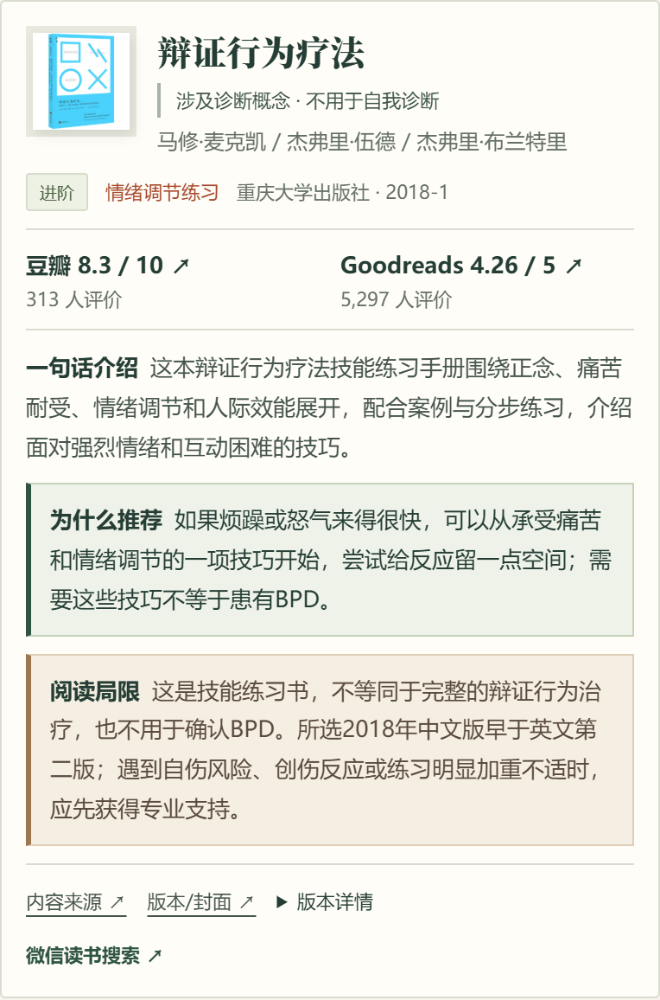
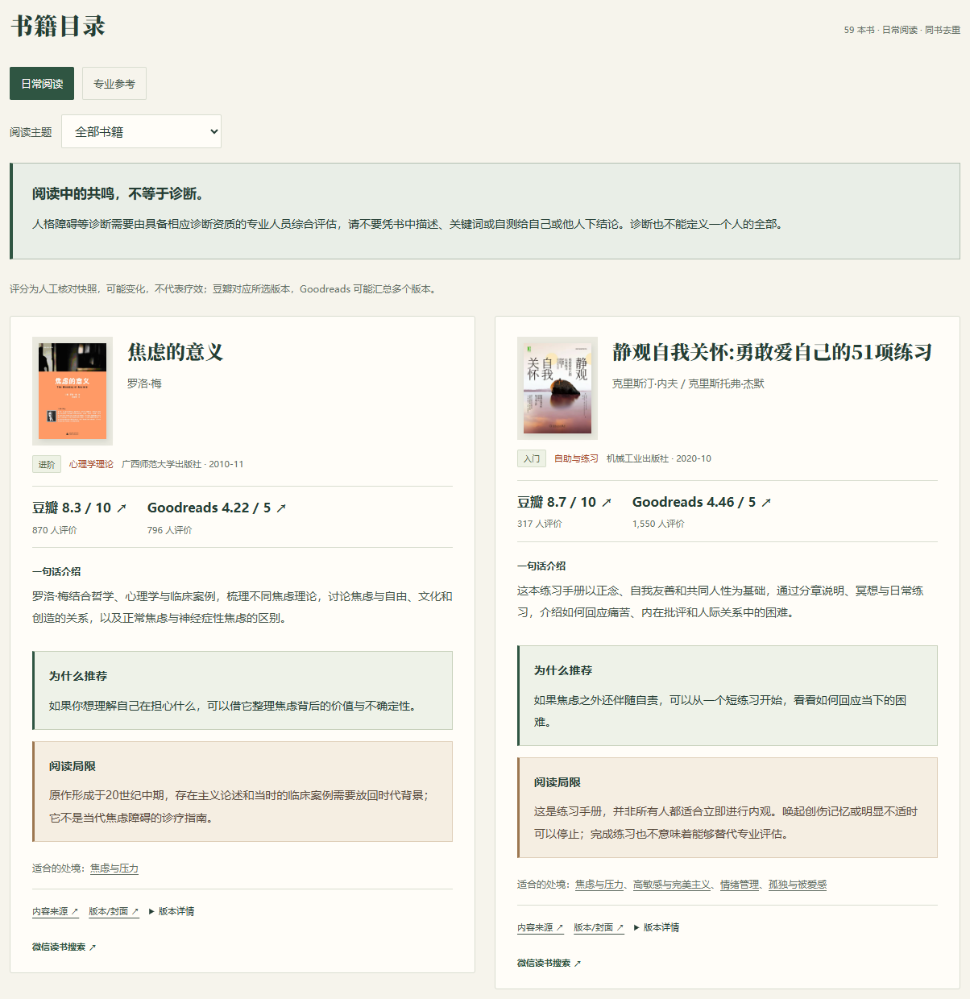
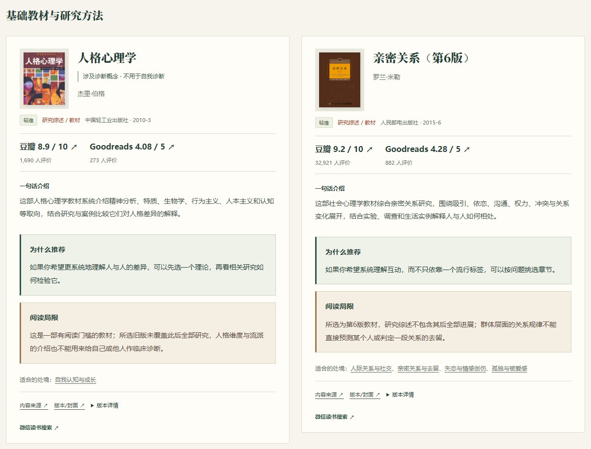

# 困境书单：写给曾经的自己

从高中到大学，我总是陷入各种各样的烦扰。那时还没学会向人求助，所以，我最大的期盼之一，就是读到一本能解决当下困扰的书。

我很清楚，只思考、不行动，生活不会因此发生什么改变。但我又是一个有些固执的人，常常需要先改变认知，才能改变习惯。

所以，我想做一份从困境出发的书单。

这份书单，是做给当年的自己，也是做给所有和我有相同需求的人：心里有一些说不清、放不下的问题，想借阅读理解它们，却不知道从哪本书开始。

我把它做成了一个小网站，叫作 **“困境书单”**。

*网站首页。可以从一句困扰开始，也可以直接逛书单。*

## 先写下最近的困扰

打开网站，首页会问：“最近，什么事让你有些困扰？”

在输入框里写一句平时会说的话，再点击“找一本书”，就能查看相关主题的书单。不需要先知道心理学术语，也不用把自己的经历整理成一篇完整的自述。

比如，可以试试这些表达：

- “我最近很烦躁。”
- “我感觉没人爱我。”
- “我要换工作，但不知道怎么选。”

前两句分别会进入“情绪管理”和“孤独与被爱感”。结果页会保留原来的描述，方便对照：这个方向，是否接近自己真正想说的事？

*搜索后先给出一个阅读方向，也允许继续调整。*

目前，网站有17个阅读主题，涵盖情绪、自我认知、人际关系、职业选择、学习、健康等方面。搜索采用关键词匹配，还不能理解所有表达，尤其容易漏掉说得比较含蓄、带有否定或多层意思的句子。

如果方向不对，可以使用结果页上的“换个阅读方向”下拉框，直接选择更贴近的主题。有多个方向同时命中时，页面也会列出最多三个其他方向供选择。

切换时，刚才写下的话和已经选择的阅读偏好都会保留，不用重新输入。

## 再选一种现在读得进去的方式

同样是烦躁，有时想知道为什么会这样，有时只想试一个具体方法。有些日子精力不够，读理论也很费劲，可能更愿意读一段别人的经历。

结果页的“调整读法”默认收起，点开后有四个选项：

- **全部**：保持默认顺序。
- **理解原因**：把偏向解释和理解的书排在前面。
- **尝试方法**：优先看到练习、技巧和行动方面的读物。
- **故事陪伴**：优先看到叙事类作品。

这些选项只调整顺序，其他推荐仍然保留。某个主题没有适合所选读法的书时，页面会说明，不会为了凑数把所有作品都归成同一种用途。

*选择“尝试方法”后，符合这一用途的书会排到前面。*

也可以点开“阅读建议与边界”，看看这个主题适合怎样开始、有哪些需要留意的地方。它是补充说明，不必读完才继续看书。

## 看看推荐理由，也看看局限

我希望书卡能提供足够的信息，让人决定要不要读。

目前，网站共收录64部不同作品。每张书卡都会直接展示封面、作者、出版信息、阅读门槛、评分、评价人数和一句话介绍。阅读门槛分为“入门”“进阶”“较难”，主要反映术语和内容的复杂程度，是编选时的判断。

其中，我特别想保留的两块内容是“为什么推荐”和“阅读局限”。

绿色区块说明这本书与当前困扰有什么关联，适合从哪个角度读。同一本书出现在不同主题时，推荐理由也会随处境变化。

暖砂色区块则说明它的限制。一本书可能受作者个人经验、时代与社会背景、理论立场或版本新旧影响。有些观点值得理解，有些练习需要留意适用条件，这些都应该在开始阅读之前说清楚。

*书卡保留完整的介绍、推荐理由和阅读局限。*

豆瓣与Goodreads的评分、分制和评价人数会直接显示，也可以点击进入平台条目核对。分数是人工核对时的快照，会发生变化；豆瓣对应所选版本，Goodreads可能汇总多个版本。读者评分可以参考，但不能代表临床效果，也不能替代对具体内容的判断。

想进一步了解一本书，可以点击“内容来源”或“版本/封面”。ISBN和选版说明放在“版本详情”里，展开即可查看。“微信读书搜索”用于查找书籍，可读版本以平台为准。

手机端的结果书单支持左右滑动，也有“上一本”“下一本”和当前位置提示。可以一本一本看，不必连续翻过很长的列表。目录和专业书架仍然纵向排列，方便扫读和比较。

## 暂时说不清，就先逛书单

有时，我们只能说出“最近不太好”，还不知道问题究竟在哪里。这种时候，可以点击首页的“先逛书单”，或者顶部的“书籍目录”。

日常阅读目录目前有59部作品，同一本书只展示一次。使用“阅读主题”下拉框，可以缩小范围；选择“全部书籍”，就能恢复完整目录。目录书卡上也有相关主题入口，可以沿着一本书继续寻找阅读方向。

*日常目录按作品去重，支持主题筛选。*

搜索没有匹配到主题时，也会进入目录，保留刚才的描述，并给出可能接近的主题供确认。可以继续浏览，也可以返回修改。

## 想系统学习，可以打开专业参考

目录中还有一个独立的“专业参考”入口，目前收录14本，分为“基础教材与研究方法”和“临床与治疗参考”两组。

其中有《人格心理学》《亲密关系》《认知心理学及其启示》《健康心理学》等教材，也有社会心理学、心理学研究方法和认知疗法方面的专业作品。各主题都有“较难”的深入阅读选择，原来的易读推荐仍保留在前面；其中人生意义主题的深入读物是哲学作品。部分教材同时保留在日常主题里，两个入口共用同一份书籍资料，不重复计入作品总数。

*专业参考提供深入阅读的选择，旧版内容和阅读门槛也会在书卡里说明。*

临床专用参考不会进入普通搜索推荐。阅读这些作品，也不能替代专业资质、训练和督导。

## 阅读时，请给自己留一点余地

做这份书单时，我很在意一件事：读到某段描述，觉得“这说的就是我”，不应该成为给自己下定义的开始。

涉及诊断概念的书目，页面会明确提醒：阅读中的共鸣不等于诊断。人格障碍等诊断需要由具备相应资质的专业人员综合评估，不能凭一本书、几个关键词或自测给自己和别人下结论。一个诊断也不能定义一个人的全部。

书籍不能替代专业帮助。困扰持续影响生活时，可以向医生或合格的心理专业人员求助，不必等看完一本书。

网站无需登录，输入不上传。使用记录保存在当前浏览器，可以在页脚的“本地使用记录”中导出或清除。

如果你也有一件暂时想不明白的事，欢迎打开网站，写一句试试。

**使用入口：[困境书单](https://nvnv19309.github.io/kunjing-shudan/)**

如果没有匹配上，或者推荐让你觉得偏离了原意，也欢迎告诉我：你写了什么，以及更想找到哪个方向的书。
